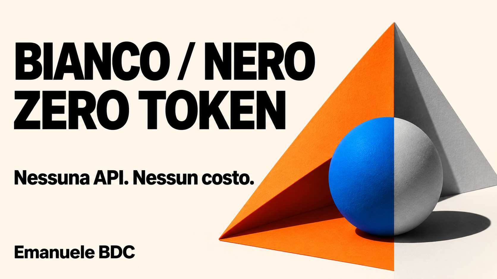
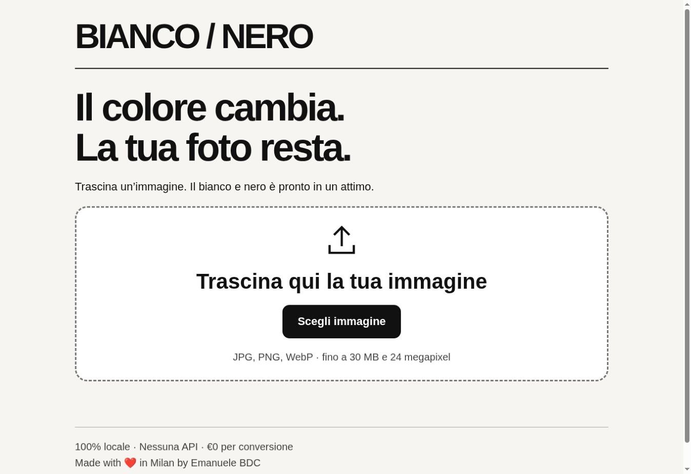
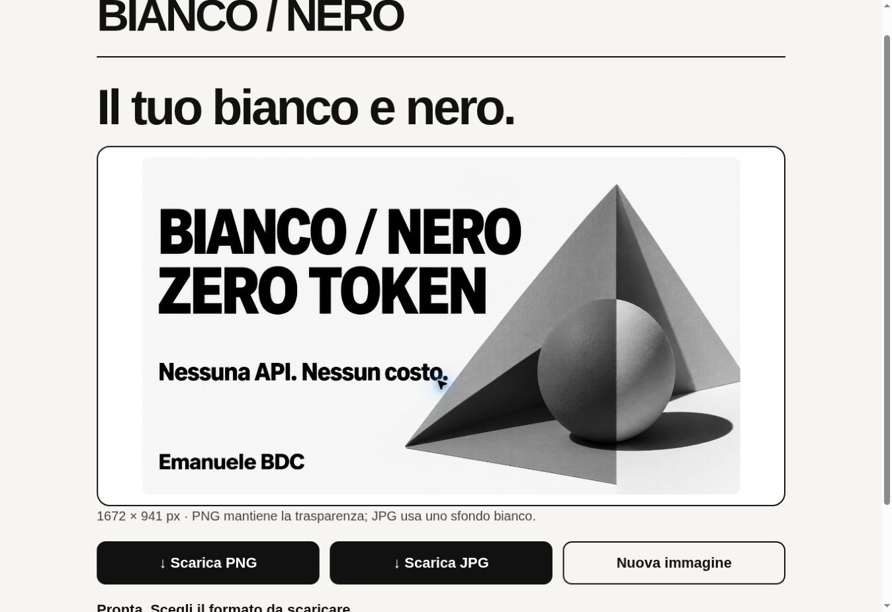

# Bianco / Nero — Zero Token



**La stessa immagine, in scala di grigi. Nessuna API. Nessun token. Nessun costo per conversione.**

Web app statica di Emanuele BDC: carica una foto, visualizza il bianco e nero e scaricalo. Elaborazione sul dispositivo, senza account e senza backend.

## Avvio immediato

1. Da GitHub scegli **Code → Download ZIP** ed estrai l'archivio.
2. Apri `index.html` con doppio clic.
3. Trascina un'immagine oppure premi **Scegli immagine**.
4. Scarica **PNG** o **JPG**. Usa **Nuova immagine** per ricominciare.

Non servono Python, Node, build o installazioni per la modalità HTML.

## Screenshot reali

### Caricamento


### Risultato


La copertina è generata con AI e usata come immagine di prova negli screenshot. La conversione dell'app non utilizza AI.

## Funzioni

- Drag & drop e selezione tramite pulsante.
- Conversione automatica in scala di grigi nel browser.
- Dimensioni originali conservate, nessun ritaglio.
- PNG con trasparenza; JPG con sfondo bianco e qualità 95%.
- Interfaccia responsive, testi grandi, focus visibile e messaggi accessibili.
- Modalità offline; manifest e service worker per l'installazione PWA.

## Formati e limiti

| Voce | Supporto |
|---|---|
| Input | JPEG, PNG, WebP |
| Output | PNG, JPEG |
| Peso massimo | 30 MiB |
| Dimensioni massime | 24 megapixel; 16.384 pixel per lato |
| Animazioni | Un singolo fotogramma, nessuna animazione esportata |
| Metadati EXIF/IPTC | Non conservati nell'esportazione |
| RAW, HEIC, SVG, PDF | Non supportati |

La conversione usa una somma pesata dei canali RGB: `round(0.2126R + 0.7152G + 0.0722B)`, lasciando invariato il canale alpha. È una conversione semplice dei valori RGB codificati, non una pipeline fotografica con gestione colore professionale. Non ricostruisce dettagli e non modifica la composizione.

## PWA installabile

Aprire il file con doppio clic abilita la web app, ma non l'installazione PWA. Per installare è necessario servirla via HTTPS o localhost.

### Sul computer

Se Python 3 è disponibile, apri un terminale nella cartella ed esegui:

```sh
python3 start.py
```

Si apre `http://localhost:8765/index.html`. Il server ascolta soltanto sull'interfaccia locale. Premi **Installa app** quando il browser lo propone, oppure usa il suo menu. Per fermare il server: **Ctrl+C**.

### Su hosting HTTPS

Carica i cinque file applicativi elencati sotto in una cartella dedicata. Visita la pagina almeno una volta, attendi il caricamento e usa l'installazione offerta dal browser. Disponibilità e procedura dipendono dal browser e dal sistema operativo. La cache può essere eliminata dal browser; in quel caso serve visitare nuovamente la pagina online.

## Pubblicazione nella sottocartella

Destinazione richiesta: `https://emanuelebdc.com/ideas/bianco-nero-zero-token/`.

**Questo indirizzo indica la destinazione prevista, non certifica che il deploy sia avvenuto.**

Carica esclusivamente:

- `index.html`
- `manifest.webmanifest`
- `sw.js`
- `icon-192.png`
- `icon-512.png`

nella nuova cartella `ideas/bianco-nero-zero-token/` della document root del sito. I percorsi sono relativi, quindi non è necessario modificare il codice. Non sovrascrivere l'indice di `/ideas/` né altre applicazioni. Il server deve servire `.webmanifest` come JSON/manifest e `.js` come JavaScript. Non caricare `start.py` sul sito.

Per un aggiornamento, incrementa il nome della cache in `sw.js`, pubblica i file coerentemente e ricarica la pagina. Il service worker ha ambito limitato alla cartella dell'app.

## Privacy e costi

Le immagini vengono lette in memoria nel browser e non sono inviate a servizi esterni. L'app non usa API, analytics, account o archivi delle foto. Il service worker conserva solo i file dell'app. La versione ospitata effettua le normali richieste al sito per caricare l'app; il server può registrare i normali log HTTP, ma non riceve le immagini selezionate. La conversione non consuma token; eventuali costi di hosting sono separati.

## Struttura

| File | Ruolo |
|---|---|
| `index.html` | Interfaccia, stili e conversione autosufficienti |
| `manifest.webmanifest` | Nome, icone, ambito e avvio PWA |
| `sw.js` | Cache offline dell'app |
| `icon-*.png` | Icone installazione |
| `start.py` | Server locale facoltativo |
| `docs/` | Copertina e screenshot |

## Verifiche

Verificati: sintassi JavaScript, calcolo scala di grigi e alpha, formato esportazione, rifiuto di file non supportati e troppo pesanti, reset dell'interfaccia. Test reale in Chrome: caricamento PNG, visualizzazione risultato e download PNG; pixel del PNG esportato controllati. Installazione PWA, offline installato e dispositivi mobili: da verificare sui dispositivi destinatari.

## Problemi comuni

- **Il file non si apre:** estrai prima lo ZIP e apri `index.html` con il browser.
- **Il pulsante Installa non compare:** usa HTTPS/localhost, verifica il supporto del browser e controlla se l'app è già installata.
- **Immagine rifiutata:** verifica formato, peso e dimensioni.
- **Versione precedente dopo un aggiornamento:** ricarica o cancella i dati del sito; l'app non conserva fotografie.

## Crediti

Made with ❤️ in Milan by **Emanuele BDC** — [emanuelebdc.com](https://emanuelebdc.com/).
